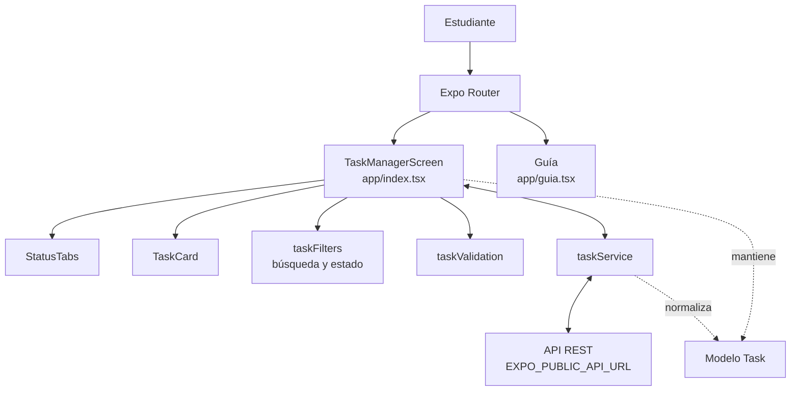

# Arquitectura

La aplicación está organizada en rutas de Expo Router, componentes de interfaz,
utilidades de dominio y un servicio HTTP que adapta la API al modelo `Task`.

## Responsabilidades

- `app/index.tsx` coordina la pantalla, el estado, las acciones y la carga de
  tareas.
- `src/components/TaskCard.tsx` representa una tarea y permite cambiar su
  estado, expandir su descripción y eliminarla.
- `src/components/StatusTabs.tsx` permite seleccionar el filtro por estado.
- `src/utils/taskFilters.ts` filtra localmente por estado y texto.
- `src/utils/taskValidation.ts` valida el título antes de crear una tarea.
- `src/services/taskService.ts` realiza las solicitudes HTTP y adapta los
  registros del backend al tipo `Task` de la aplicación.
- `src/types/task.ts` define los tipos compartidos por la interfaz y el servicio.

## Flujo de datos

1. `TaskManagerScreen` carga las tareas al montarse y las guarda en su estado.
2. `taskService` construye la URL con `EXPO_PUBLIC_API_URL`, envía la solicitud
   y convierte cada respuesta al tipo `Task`.
3. La pantalla aplica búsqueda y filtros locales antes de mostrar las tareas.
4. Crear, actualizar o eliminar realiza primero la operación en la API; el
   estado local se actualiza al recibir una respuesta exitosa.
5. Si la API devuelve un error HTTP, el servicio rechaza la operación y la
   pantalla muestra un mensaje de error.

## Configuración

La única variable que consume el servicio es `EXPO_PUBLIC_API_URL`, la URL base
del backend. El servicio no implementa autenticación. Las variables con prefijo
`EXPO_PUBLIC_` se incluyen en el bundle de la aplicación, así que no deben
contener secretos.

## Contrato usado por el cliente

Todas las rutas se concatenan a la URL base. La lectura usa paginación con
`skip` y `limit`; la aplicación solicita páginas de 100 registros hasta recibir
una página más corta.

| Operación | Método y ruta | Uso |
| --- | --- | --- |
| Listar tareas | `GET /tasks/?skip={n}&limit=100` | Obtiene las tareas por páginas. |
| Crear tarea | `POST /tasks/` | Envía `title`, `description` y `completed`. |
| Actualizar tarea | `PUT /tasks/{id}` | Envía `title`, `description` y `completed`. |
| Eliminar tarea | `DELETE /tasks/{id}` | Elimina la tarea identificada. |

El cliente convierte el identificador de la respuesta a texto, reemplaza una
descripción nula por una cadena vacía y asigna prioridad `media`, ya que la API
no incluye prioridad en su contrato.
